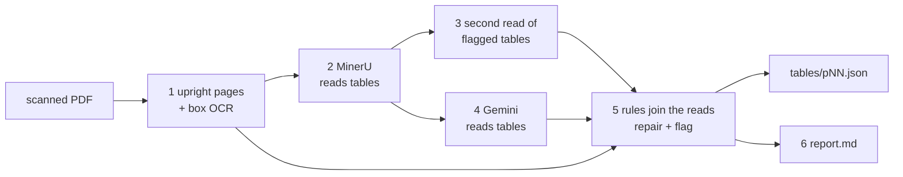

# Vidoc-parse

Document parsing for scanned Vietnamese reports: a PDF whose pages are only images goes in, a readable, copyable document comes out.

Two parts:

| part | status | does |
|---|---|---|
| **tables** (`tables/`) | built | every table of the report as a grid of cells, plus flags where it may be wrong |
| **text** | in progress, separate | running text, headings and their layout |

The two meet at the end: tables are placed among the text blocks of their page (each table carries its box on the page), and one document file is written.

## Table part: how it works



| stage | tool | role |
|---|---|---|
| 1 | PyMuPDF + PP-OCRv6 small, Vietnamese (RapidOCR, CPU) | turn pages upright; list every text line and amount printed on the page |
| 2 | MinerU2.5-Pro (GPU) | main reader: digits, dashes, columns |
| 3 | MinerU again | reread a table from a wider crop when a check says it is incomplete |
| 4 | Gemini Flash (API) | independent second read, used only for Vietnamese spelling and row grouping |
| 5 | rules, no model | MinerU's grid is the base; a cell changes only with proof (two readers agree, or a sum holds) |
| 6 | no model | counts and every flag, for a person to check |

Input: `report.pdf`. Output, per page with a table: `data/<name>/tables/pNN.json` with the grid, column roles, the table's box on the page, where each cell came from, what the rules changed, and the flags.

## Requirements

- Linux with an NVIDIA GPU (MinerU runs vLLM). GPU memory: MinerU peaked at 6.7 GB on a 16 GB card (RTX 4060 Ti).
- [uv](https://docs.astral.sh/uv/getting-started/installation/); it fetches Python 3.12 itself.
- Disk: about 11 GB besides the documents: MinerU's environment 8.2 GB, its model weights 2.5 GB (downloaded on the first run), the pipeline's environment under 1 GB.
- A Gemini API key (stage 4).

## Run

```bash
git clone https://github.com/Min-KiD/Vidoc-parse.git && cd Vidoc-parse
./setup.sh                                  # once: .venv, .venvs/mineru, and .env from .env.example
# edit .env: GEMINI_API_KEY=...
tables/run_doc.sh report.pdf data/report    # all six stages
.venv/bin/python -m pytest tables/tests     # tests, no GPU or key needed
```

Model weights are fetched by the code, not by hand: `rapidocr` downloads PP-OCRv6 small for Vietnamese (detection 9.9 MB, recognition 21 MB) into its package folder on first use, MinerU2.5-Pro is downloaded into `.cache/` on its first use. Everything a run writes (page images, the readers' output, the final tables) stays in `data/<name>/`; `data/`, `.cache/`, the environments and `.env` are not committed.

Tested end to end on 2026-11-17 on one Linux machine with one GPU and one CPU (Ryzen 5 5500, RTX 4060 Ti 16 GB) with the 72-page VIC report: 404 s in all, same score as before (8 wrong cells, 3 content). MinerU and Gemini start at once and take each page as soon as it is ready; MinerU reads one page at a time on purpose (more is faster but changes its reads). Measured settings and the one worth tuning on another machine (`PREP_JOBS`): `architecture_design.md` section 5.

`examples/VIC/` shows what one document folder holds, for two pages of the test report VIC: a balance sheet (p06) and a note whose total row MinerU first missed and got on the second read (p55). Each stage's file is there (`ocr/`, `mineru/`, `gemini/`, `tables/`); the page images are not.

## More

- `architecture_design.md`: the pipeline in detail, every rule and flag, the output format, what joining with the text part still needs.
- `FINDINGS.md`: what was tried, what worked, what not to try again.
