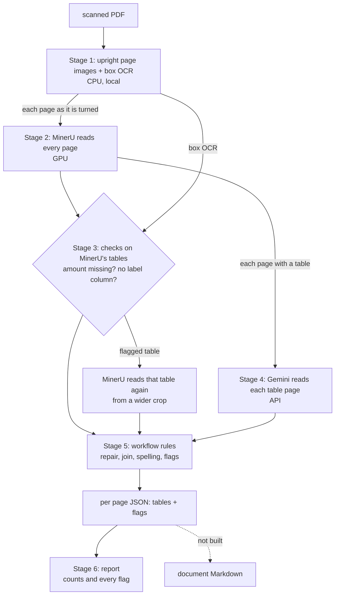

# Architecture: tables from a scanned financial report

State on 2026-11-17. This describes the final pipeline in `tables/`, in the order the data flows. What it rests on, in short, is in `FINDINGS.md`; this file explains how the parts fit.

## 0. Read this first: what the output is today

- **Input:** one scanned PDF (every page is an image, no text layer). Tested on three Vietnamese Q3/2025 reports: VIC (72 pages), DXG (54), NVL (90).
- **Output today:** one JSON file per page that has a table: the tables as grids of cells, plus flags that say where the grid may be wrong. **It is not Markdown.**
- **Not built:** the layout-aware document file for the whole report. That file needs the text part and one decision nobody has made yet: where each table sits among the text blocks of its page. Section 8 says what is missing.
- **Scope:** tables only. Running text, headings and page furniture are not handled here.
- **One command**, `tables/run_doc.sh`, runs the six stages on one machine with an NVIDIA GPU (section 7).

## 1. The idea in five sentences

1. No single reader is right everywhere, but each is right at something: MinerU at digits, dashes and columns; Gemini at Vietnamese spelling and at which printed lines form one row; box OCR at "which amounts are printed on this page".
2. So MinerU's table is the base, and nothing replaces a MinerU cell unless a rule says why.
3. Gemini only corrects the spelling of a text MinerU also read. It never supplies numbers, dashes or new content.
4. Box OCR never supplies a cell. It is a witness: if it sees an amount on the page that no cell holds, something is missing.
5. Whatever cannot be repaired with proof is flagged for a person, not guessed.

## 2. The pipeline



The arrows are what each stage needs; stages without an arrow between them run at the same time (section 7).

| stage | does | tool | where | script | writes |
|---|---|---|---|---|---|
| 1 | render pages at 200 dpi, turn them upright, read text lines with positions | pdf render, PP-OCRv6 small, Vietnamese (RapidOCR) | local CPU, about 4 s per page | `tables/prepare.py` | `pages/pNN.png`, `ocr/pNN.json`, `orientation.json` |
| 2 | read each page into Markdown with HTML tables and block boxes | MinerU2.5-Pro | GPU, 3.6 s per page | `tables/run_doc.sh`, `tables/mineru/` | `mineru/pNN.md`, `pNN.raw.json` |
| 3 | find tables whose first read is incomplete, read them again, keep the better read | checks + MinerU | local + GPU | `tables/reread.py` | `reread/`, `mineru/reread.json` |
| 4 | read each table page as structured tables | Gemini 3.8 Flash, about $0.005 per page | API | `tables/gemini_read.py` | `gemini/pNN.json` |
| 5 | build the final grid from the three reads, and flag it | rules, no model | local | `tables/workflow.py` (checks in `flag_checks.py`, `forms.py`, `coverage.py`, `identities.py`) | `tables/pNN.json` |
| 6 | one page of counts and every flag | no model | local | `tables/report.py` | `report.md` |

All paths are under the document's folder, `data/<name>/`. Shared code: `tables/grid.py` (cells, MinerU HTML to grids, column roles, row and column joins) and `tables/doc.py` (the document folder and its files).

## 3. Stage by stage

### Stage 1: pages and box OCR

- Each page is rendered to a PNG and turned upright. Direction is decided from the page itself: text runs along the long side of its boxes, so a page whose boxes are mostly vertical lies sideways; then the 10 longest lines are read as they are and turned by 180 degrees, and the way up with the higher recognition scores wins. Only lines that read as words (3 letters or more) vote, so marks, logos and near-symmetric numbers such as `59 - 68` do not; more lines are read only when fewer than 3 of the 10 are words. No page list, no orientation model.
- Box OCR gives every text line with its position. It is a poor reader of tables (it has no notion of cells) but it reliably lists the amounts printed on a page.

### Stage 2: MinerU

- A small document model. For each page it returns blocks (text, table, header) with boxes, and each table as HTML.
- Our parser turns the HTML into a grid (rows of cells), expanding `rowspan` and `colspan`.
- What it is good at: digits (1 misread amount in 3780 over the three files), printed dashes, column positions.
- Its known faults: two printed lines in one cell; a wrapped label split into two rows; a dash dropped; the total line under a table left outside the table box; a label column or a value column lost; wrong tone marks in Vietnamese words.

### Stage 3: the second read

- Two checks run on MinerU's own tables: (a) box OCR reads an amount on a line of its own, under or beside the table, that no cell holds; (b) most rows of the table have amounts and no words.
- A flagged table is cut from the page again, full page width, down to the lowest flagged line, and MinerU reads the crop.
- The second read replaces the first only when it holds every amount the first held and has fewer flags. Otherwise the first read stands.
- Effect on the three files: 6 of 11 flagged tables improved (3 missing total rows, 3 missing label columns).

### Stage 4: Gemini

- One call per table page, asking for the tables as rows with a label and values.
- Used for two things only: the spelling of text cells, and which printed lines belong to one row.
- Why not more: it drops printed dashes and then shifts numbers into the wrong column, invents values in rows of dashes, and adds text the page does not print.

### Stage 5: the workflow rules

They run in this order on each page. "Join" means: decide which Gemini row is the same printed row as a MinerU row.

| order | name | what it does | proof it needs |
|---|---|---|---|
| 1 | rule 1 | a cell with exactly two amounts above an empty cell: the second amount moves down | the empty cell under it |
| 2 | rule 3 | `4,835.204` gets the separator the table's other amounts use | the other amounts of the table |
| 3 | join | MinerU rows and Gemini rows with the same amounts are the same row; rows without amounts between two joined rows are joined by position when their counts match | equal amounts |
| 4 | step 3 (regroup) | MinerU rows that together show the text of one Gemini row are merged into one row | MinerU's own text equals Gemini's row |
| 5 | step 3b (text join) | a row without amounts that is still not joined takes the next Gemini row with the same letters and digits | 90% same letters and digits |
| 6 | step 4 | a total row only Gemini has is added, amounts only | each amount equals the sum of the amounts above it |
| 7 | rule 4 (digit vote) | a MinerU amount box OCR reads nowhere is rewritten | box OCR and Gemini both read the same other amount, 1 or 2 digits apart |
| 8 | rule 2 (spelling) | in text and header cells of joined rows, Gemini's text replaces MinerU's | both cells have the same letters and digits at 90% |

Rule 2 is the only place Gemini's characters enter the output, apart from the amounts of step 4. It does not fill a cell MinerU left empty and does not touch a cell with no letters or digits.

### Flags (written in stage 5, listed by stage 6)

A flag is a place a person should look. It never changes a cell.

| flag | meaning | needs |
|---|---|---|
| `amount_not_in_table` | box OCR reads an amount on a line of its own that no cell holds: a row, column or table is missing | box OCR |
| `amount_unread` | a cell amount box OCR reads nowhere on the page: one of the two misread it | box OCR |
| `no_label_column` | most rows have amounts and no words | nothing |
| `form_sum_fail` | a line-code sum of the legal statement forms (B01, B02, B03) does not hold | the `Mã số` column |
| `statements_disagree` | a figure that two statements share differs | two statements |
| `coded_row_empty` | a coded statement row with no value at all: dashes were dropped | the `Mã số` column |
| `blank_or_dash` | MinerU cell empty, Gemini has a dash | Gemini |
| `amount_mismatch` | MinerU and Gemini read different amounts in the same cell | Gemini |
| `text_diff` | MinerU and Gemini read different letters or digits in a text cell | Gemini |
| `gemini_only_row` | Gemini has a row where MinerU has none, and nothing proves it | Gemini |
| `row_not_joined` | no Gemini row was found for this row; MinerU's spelling stands | Gemini |
| `malformed` | separators that cannot be an amount (`3.882.700.00`) | nothing |
| `identity_fail` | a sum discovered in the table does not hold (not on statement tables) | nothing |

## 4. The output file

`data/<name>/tables/pNN.json`:

```json
{
  "page": 46,
  "tables": [{
    "title": "...",
    "bbox": [x0, y0, x1, y1],
    "header_rows": [0],
    "roles": ["label", "value", "value", "value", "value"],
    "rows": [["TỔNG CỘNG", "469.617.301.597", "508.025.190.711", "...", "..."]],
    "text_source": [["mineru", "mineru", "mineru", "mineru", "mineru"]],
    "mineru_rows": [[5]]
  }],
  "flags": [{"table": 0, "row": 3, "col": 1, "kind": "blank_or_dash"}],
  "changes": [{"kind": "table_reread", "table": 0}],
  "rows_joined": {"amounts": 13, "position": 2, "regroup": 0, "text": 0, "total": 15}
}
```

- `rows`: the grid, cells as printed strings (`83.455.099`, `(130.770)`, `-`).
- `bbox`: the table's box on the upright page image, in pixels.
- `roles`: what each column is (`label`, `code`, `note`, `value`, `text`).
- `text_source`: per cell, who the characters come from (`mineru`, `gemini`, `gemini (text join)`, `ocr+gemini`).
- `mineru_rows`: per output row, the MinerU rows it was built from.
- `changes`: what the rules did on this page.

## 5. How well it works

| | VIC | DXG | NVL |
|---|---|---|---|
| answer key | human-checked, 3869 cells | none | none |
| wrong cells | 8 (3 content, 5 tone marks or capitals) | - | - |
| MinerU alone on the same cells | 168 (69 content) | - | - |
| sample of rows read from the page by a blind reader | 30 rows, 29 same | 60 rows, 57 same | 59 rows, 48 same |
| amounts, dashes or blanks that differ in the sample | 0 | 0 | 0 |
| flags | 48 (48 pages) | 88 | 166 |

- VIC is the file the rules were written on, so its score is the best case.
- The 8 wrong cells are with the Gemini reads made on 2026-11-10/11 and kept since. Gemini does not answer the same way twice: four fresh reads of VIC on 2026-11-16 gave 16 to 21 wrong cells, every extra one a tone mark, capital or punctuation (3 content errors in every run). MinerU at one page in flight gave the same score in every run.
- DXG and NVL have no answer key. The sample bounds the error rate, it does not measure it: a kind of fault not met in 60 rows can still be in about 5% of rows.
- The sample reader is a model reading images, not a person. On VIC it equals the human-checked key in 173 of 173 cells.

Speed on one machine with one GPU and one CPU (RTX 4060 Ti 16 GB, Ryzen 5 5500 6 cores / 12 threads), VIC 72 pages, scored with the same kept Gemini reads:

| setting | wall time | wrong cells (content) |
|---|---|---|
| stages one after the other (before 2026-11-16) | about 25 min | 8 (3) |
| stages side by side, stage 1 with half the CPU threads | 465 s | 8 (3) |
| same, stage 1 with a third of the threads (default) | 402-404 s | 8 (3) |
| MinerU alone, 1 / 2 / 4 / 8 pages in flight, 3 runs each | 300 / 191 / 147 / 127 s | 8 (3) / 10 (3) / up to 12 (5) / up to 10 (3) |

- MinerU reads one page at a time by default: more pages at once is faster but changes MinerU's reads from run to run and added content errors in some runs. Even at one page, one run of three differed on one table (p65).
- Stage 1 shares the CPU with MinerU, which needs it to keep the GPU fed. With half the threads MinerU took 4.9 s per page instead of 4.1; with a third, the box OCR ends about 20 s after MinerU. On another machine `PREP_JOBS` is the one setting worth trying: raise it when `[..] box OCR done` comes long after `MinerU read`.

## 6. Known limits

- **Flagged, not repaired:** a value column MinerU does not read (NVL p11, 19 amounts); a label column the second read does not bring back (DXG p44); lines under a table that are not a total (DXG p38); two text lines in one cell (DXG p39, p43).
- **No flag sees it:** an empty printed column that MinerU drops, which shifts the header by one column (NVL p13); a heading that spans the row, placed in the first column; a dropped dash that Gemini also dropped.
- **Capitals:** both readers misread them; no rule decides.
- **Gemini may refuse a page** (finish reason RECITATION, its filter against copying published text). VIC p61 was read on 2026-11-11 and refused in every run of 2026-11-16. On such a page the spelling is MinerU's and no Gemini check ran; `report.md` names these pages.
- **Rules 1 and 3** fired on VIC only. They did nothing on the other two files.
- **Form checks** know the Vietnamese statement forms (Circular 200/202). Other tables have only the generic checks.
- **Unseen files:** DXG and NVL were looked at before the last rules were written. No third file has been run.

## 7. How to run it

```bash
./setup.sh                                   # once; then GEMINI_API_KEY in .env
tables/run_doc.sh <report.pdf> data/<name>
```

`setup.sh` makes two environments with uv: `.venv` (requirements.txt, stages 1 and 3-6; it also fetches PP-OCRv6 small) and `.venvs/mineru` (MinerU 4.2.0 with vLLM 0.20.2, exact versions in `tables/mineru/requirements.txt`, stages 2 and 3). Every cache and MinerU's weights go to `.cache/` (`tables/mineru/env.sh`). `run_doc.sh` reads `.env` (settings listed in `.env.example`).

The stages are numbered by what they need, not run one after the other. `run_doc.sh` starts three processes at once:

- **MinerU** (`tables/mineru/run_mineru.sh`, GPU) loads its model and reads each page image the moment stage 1 writes it (`--until pages/.done`). After the last page it waits, model loaded, for the crops of stage 3 and reads them too: the model is loaded once per document.
- **Gemini** (`python -m tables.gemini_read --follow`, network, 8 calls at a time) reads each page as soon as MinerU's `pNN.md` shows a table on it.
- **Stage 1** (`python -m tables.prepare`, CPU, one process per three CPU threads by default (`PREP_JOBS`), so that MinerU keeps enough CPU to feed the GPU) turns the pages upright; when all are written, the box OCR of every page starts.

When MinerU has read every page and the box OCR is done, `python -m tables.reread crops` cuts the crops of stage 3; MinerU reads them; `compare` and `accept` keep the better reads. When Gemini is done, `python -m tables.workflow` and `python -m tables.report` write the output. MinerU reads one page at a time on purpose (`MINERU_JOBS`, default 1): with several in flight the reads change from run to run (section 5).

On a shared GPU, `GPU_LOCK` names a lock file the other jobs take with flock; MinerU then takes it too and waits until the GPU memory is free. Each step skips the pages it already did, so a stopped run is resumed by running it again; a run of a finished document takes seconds and does not load MinerU's model. A run that fails or is interrupted stops every process it started. Every module also runs on its own with the document folder as argument. The script stops with a message when a stage fails or MinerU reads no page, and warns when Gemini leaves a page unread.

VIC page 4 is not in the output: MinerU sees no table there (only PaddleOCR-VL did, in the experiments), so VIC has 48 pages of tables, not 49.

Everything a run writes stays in `data/<name>/`, which is not committed. Once a document has its reads (stages 1 to 4), stages 5 and 6 can be rerun alone without the GPU or the API. Tests: `python -m pytest tables/tests`.

## 8. From here to a layout-aware Markdown file

What exists that the Markdown needs:

- every table as a grid, with header rows marked and its box on the page;
- MinerU's other blocks of each page (text, titles) with their boxes and reading order, in `mineru/pNN.raw.json`. Nothing uses them yet.

What is missing:

1. **Rendering:** grid to Markdown or HTML table. A Markdown pipe table cannot hold merged header cells or a line break in a cell; statements with two header rows need HTML `<table>` inside the `.md`, or a flattened header.
2. **Placement:** where the table goes among the page's text. The table's `bbox` and the text blocks' boxes are in the same pixel space if the text part uses the same upright page images; that has to be agreed.
3. **The text itself:** comes from the text part. Which reader, and whether its block boxes exist, is not known here.
4. **Tables across pages:** a statement that runs over three pages is three tables today. Nothing joins them.
5. **Flags in a document for readers:** shown, hidden, or kept in a side file.
